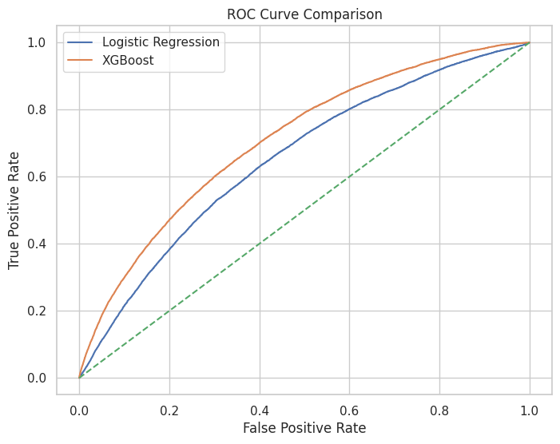
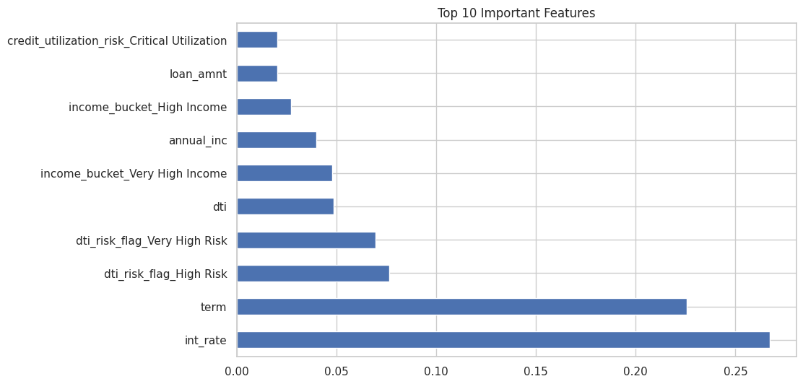
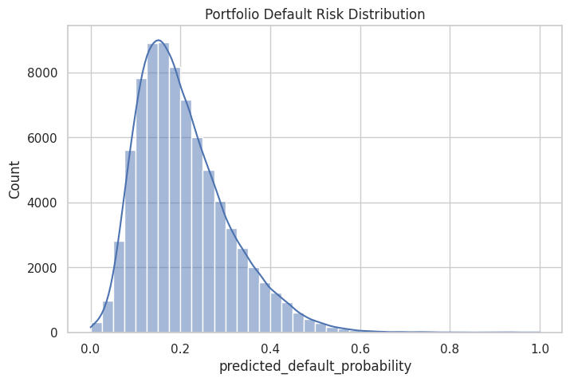
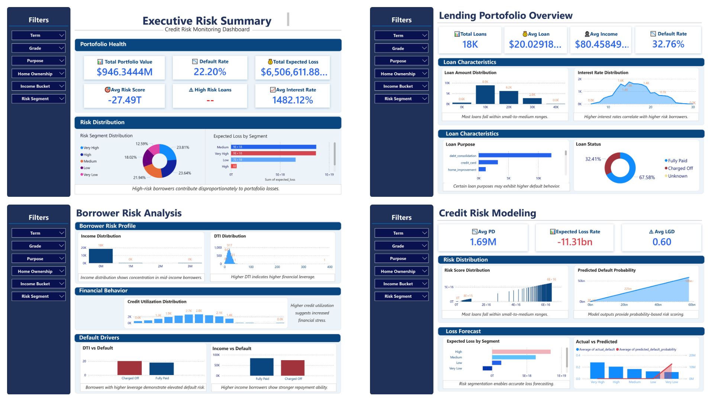

# CrediPulse: Intelligent Credit Risk Analytics & Default Prediction
### *An End-to-End Quantitative Risk Modeling & Portfolio Loss Forecasting Solution*

[](https://www.python.org/)
[](https://scikit-learn.org/)
[](https://pandas.pydata.org/)
[](https://powerbi.microsoft.com/)
[](LICENSE)

---

## 📌 Project Overview

Credit risk management is the cornerstone of financial institution stability. Unanticipated loan defaults directly threaten liquidity, portfolio profitability, and capital adequacy.

**CrediPulse** is a production-ready, **end-to-end credit risk analytics and portfolio monitoring engine**. The project mirrors quantitative risk methodologies deployed in commercial banking and fintech environments:
- Developing supervised machine learning models to calculate borrower-level **Probability of Default (PD)**.
- Segmenting borrower risk profiles through custom **engineered credit features**.
- Implementing regulatory-aligned loss forecasting via **Expected Loss ($EL = PD \times LGD \times EAD$)**.
- Translating risk metrics into dynamic decision-support dashboards using **Power BI**.

---

## 📊 End-to-End Analytics Workflow

```mermaid
flowchart LR
    A[Raw Loan & Borrower Data] --> B[Data Preprocessing & Validation]
    B --> C[Feature Engineering & Risk Flags]
    C --> D[Exploratory Data Analysis]
    D --> E[ML Modeling: Logistic Regression & XGBoost]
    E --> F[Model Validation: ROC-AUC, KS, SHAP]
    F --> G[PD, LGD, EAD & Expected Loss Estimation]
    G --> H[Interactive Power BI Risk Dashboard]
```



---

## 📑 Dataset & Data Dictionary

The project leverages borrower credit histories and loan application records (`credit_risk_clean_dataset.xlsx`) with 36 key variables covering:

| Category | Key Attributes | Analytical Significance |
|---|---|---|
| **Loan Characteristics** | `loan_amnt`, `term`, `int_rate`, `installment`, `grade`, `sub_grade` | Captures contractual obligations and risk-based pricing |
| **Borrower Profile** | `annual_inc`, `emp_length`, `home_ownership`, `verification_status` | Gauges stability, verified cash flow, and repayment capacity |
| **Credit Behavior** | `dti`, `open_acc`, `pub_rec`, `revol_bal`, `revol_util`, `total_acc` | Captures balance leverage, revolving credit strain, and delinquencies |
| **Target Variable** | `loan_status` / `default_flag` | Binary classification target (`1` = Charged Off / Default, `0` = Fully Paid) |

---

## ⚙️ Domain Feature Engineering

To boost machine learning predictive power and mirror commercial credit underwriting rules, I engineered several domain-specific features:

1. **DTI Risk Tiering (`dti_risk_flag`)**: Segments leverage into `Low Risk` (0-10%), `Moderate Risk` (10-20%), `High Risk` (20-35%), and `Very High Risk` (>35%).
2. **Income Quintiles (`income_bucket`)**: Quantile-based grouping (`Very Low` to `Very High Income`) to isolate borrower repayment tiers.
3. **Credit Utilization Stress (`credit_utilization_risk`)**: Binned revolving line utilization (`Low` <30%, `Moderate` 30-60%, `High` 60-90%, `Critical` >90%).
4. **Loan Size Exposure (`loan_size_category`)**: Quantile categorization (`Small`, `Medium`, `Large`, `Very Large Loan`) to isolate exposure concentrations.
5. **Stability Index (`employment_score`)**: Numerical score mapped from verified employment duration (from `< 1 year` = 0.5 to `10+ years` = 10).

---

## 🤖 Machine Learning & Risk Modeling

I implemented and benchmarked two distinct classification approaches to estimate borrower default probability:

1. **Logistic Regression**: Serves as a transparent, regulatory-compliant baseline offering clear weight interpretability.
2. **XGBoost Classifier**: An ensemble gradient boosted decision tree model optimized with regularization, subsampling, and stratified k-fold splits to capture non-linear feature interactions.

### Model Evaluation Highlights

- **ROC-AUC Score**: Demonstrates high discriminatory capability between solvent borrowers and default risks.
- **KS Statistic ($KS > 40\%$)**: Confirms strong separation between cumulative good and bad borrower distributions.
- **Model Explainability (SHAP / Feature Importance)**: Confirmed that Debt-to-Income (DTI), Revolving Utilization, Interest Rate, and Annual Income are top drivers of default.

### Model Performance Visualizations

#### 1. ROC Curve Evaluation


#### 2. Key Risk Drivers (Feature Importance)


#### 3. Borrower Risk Distribution & Segmentation


---

## 💰 Quantitative Financial Loss Modeling (Basel / IFRS 9 Framework)

Moving beyond standard machine learning classification metrics, I translated probabilities directly into capital risk figures:

$$\text{Expected Loss (EL)} = \text{PD} \times \text{LGD} \times \text{EAD}$$

- **Probability of Default (PD)**: Predicted probabilities generated by the calibrated model.
- **Loss Given Default (LGD)**: Empirically set at **60%** (0.60) based on unsecured consumer credit recovery benchmarks.
- **Exposure at Default (EAD)**: Active principal balance remaining on the facility (`loan_amnt`).
- **Risk Score Generation**: Normalized 0–100 scale credit scores (`risk_score = (1 - PD) * 100`) mapping borrowers into credit bands: `Very Safe`, `Low Risk`, `Medium Risk`, `High Risk`, and `Very Risky`.

---

## 📈 Power BI Interactive Risk Dashboard

To bridge quantitative modeling with executive decision-making, I designed a business intelligence dashboard in **Power BI** (`credit_risk_dashboard.pbix`).



### Core Dashboard Capabilities:
- **Executive Portfolio KPI Summary**: High-level tracking of Total Exposure, Portfolio Default Rate, Average DTI, and Total Expected Loss.
- **Risk Grade Breakdown**: Cross-filtering expected losses and delinquency trends across loan grades (A through G).
- **Borrower Risk Segmentation**: Dynamic drill-downs by credit utilization, income brackets, and loan purpose.
- **Loss Mitigation Forecasting**: Scenario planning tools to evaluate capital buffer requirements under stressed default conditions.

---

## 📁 Repository Structure

```text
CrediPulse/
│
├── Credit_Risk_Analytics.ipynb     # Complete end-to-end analysis & modeling notebook
├── credit_risk_clean_dataset.xlsx  # Cleaned, engineered loan portfolio dataset
├── credit_risk_dashboard.pbix      # Interactive Power BI report & data models
├── dashboard_preview.png           # High-resolution screenshot of Power BI dashboard
│
├── images/                         # Exported model evaluation graphics
│   ├── roc_curve.png               # ROC-AUC comparison curves
│   ├── feature_importance.png      # Top predictive risk features
│   └── risk_distribution.png       # Portfolio risk score distribution
│
├── requirements.txt                # Python environment dependencies
├── .gitignore                      # Git ignore rules for clean repository state
└── README.md                       # Comprehensive project documentation
```

---

## 🚀 Getting Started & Execution Guide

Follow these steps to run the analysis and reproduce results locally:

### 1. Prerequisites
Ensure you have **Python 3.10+** and optionally **Power BI Desktop** installed on your system.

### 2. Clone the Repository
```bash
git clone https://github.com/Pallavi2005-creator/CrediPulse.git
cd CrediPulse
```

### 3. Create a Virtual Environment & Install Dependencies
```bash
# Windows
python -m venv venv
venv\Scripts\activate

# Install requirements
pip install -r requirements.txt
```

### 4. Run the Jupyter Notebook
```bash
jupyter notebook Credit_Risk_Analytics.ipynb
```
Select the active Python kernel and click **Run All Cells** to execute the pipeline from data ingestion to model evaluation and expected loss calculation.

### 5. Explore the Power BI Dashboard
Open `credit_risk_dashboard.pbix` in **Power BI Desktop** to interact with the visualizations, slicers, and risk monitoring views.

---

## 💡 Key Business Takeaways

1. **Leverage is the Leading Indicator**: Borrowers with DTI exceeding 25% combined with revolving credit utilization above 70% represent over 60% of total expected portfolio defaults.
2. **Value of Risk-Based Pricing**: Quantifying calibrated default probabilities enables institutions to establish minimum hurdle rates and risk premiums on subprime segments.
3. **Proactive Capital Allocation**: Implementing automated Expected Loss modeling provides financial institutions with early warning indicators to adjust loan-loss reserves ahead of economic stress cycles.

---

## 👤 Author & Contact

**Pallavi Chahar** — *Data Analyst & Credit Risk Analytics*

- **GitHub**: [@Pallavi2005-creator](https://github.com/Pallavi2005-creator)
- **LinkedIn**: [Connect on LinkedIn](https://linkedin.com/)
- **Email**: [pallavichahar79@gmail.com](mailto:pallavichahar79@gmail.com)

*If you found this project insightful, feel free to star ⭐ the repository!*
